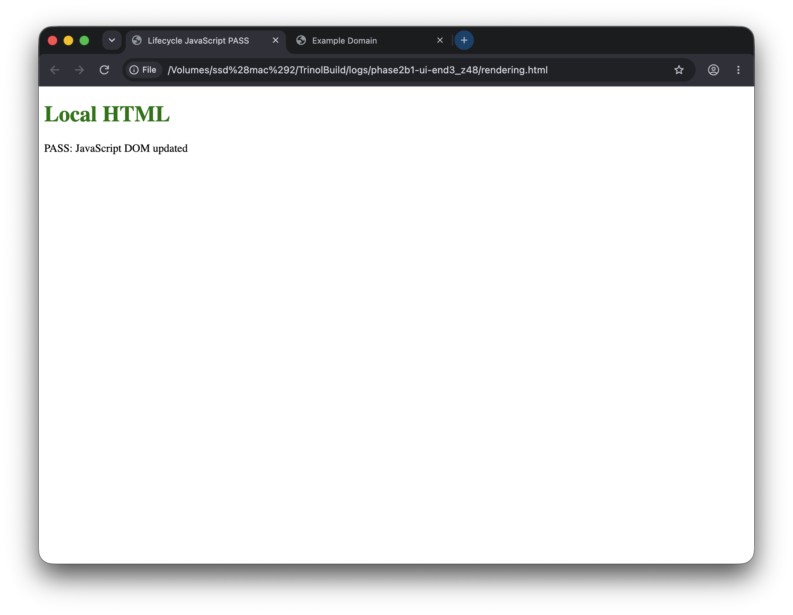
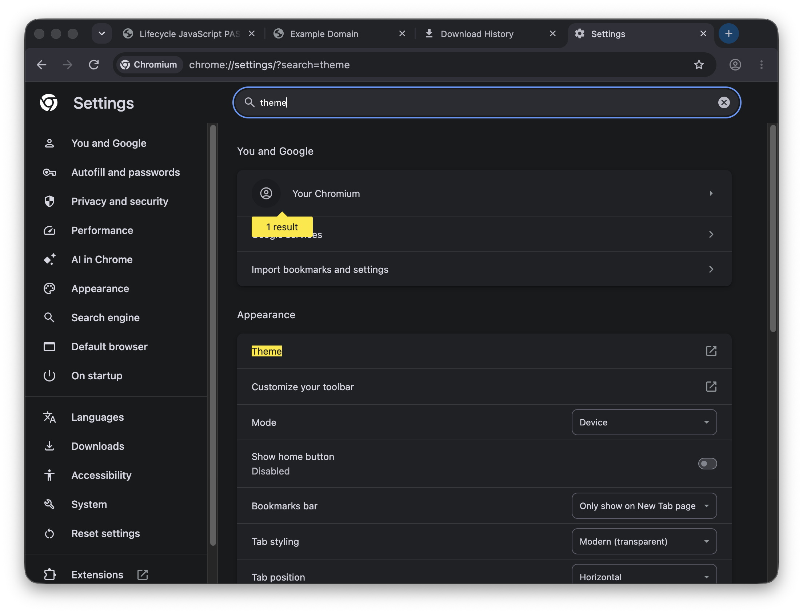

# Phase 2B1 real native captures

These two reviewed window-only captures show the actual compiled Chromium
process, PID 20381, during the single supervised UI session. They are not
prototype screenshots. Both were captured **before** the native-frame correction:
Orbit was incorrectly excluded and the visible palette is upstream Chromium.
Do not present them as proof of the corrected Orbit appearance.

The local fixture and Settings contain no personal credentials/profile data.
Raw evidence remains outside Git at `logs/phase2b1-ui-end3_z48` under the build
root. Capture used read-only CGWindowListCopyWindowInfo filtered to the owned PID,
followed by screencapture -x -l for that window ID; no app selection or activation.
See the [native report](../../../docs/phase-2b1-native-shell-report.md).

